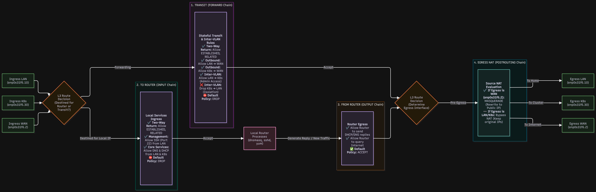
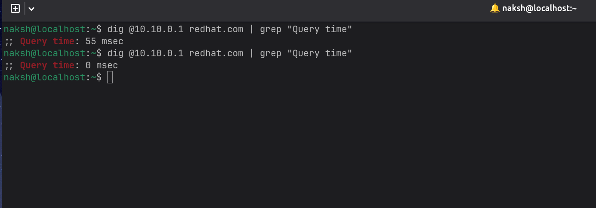
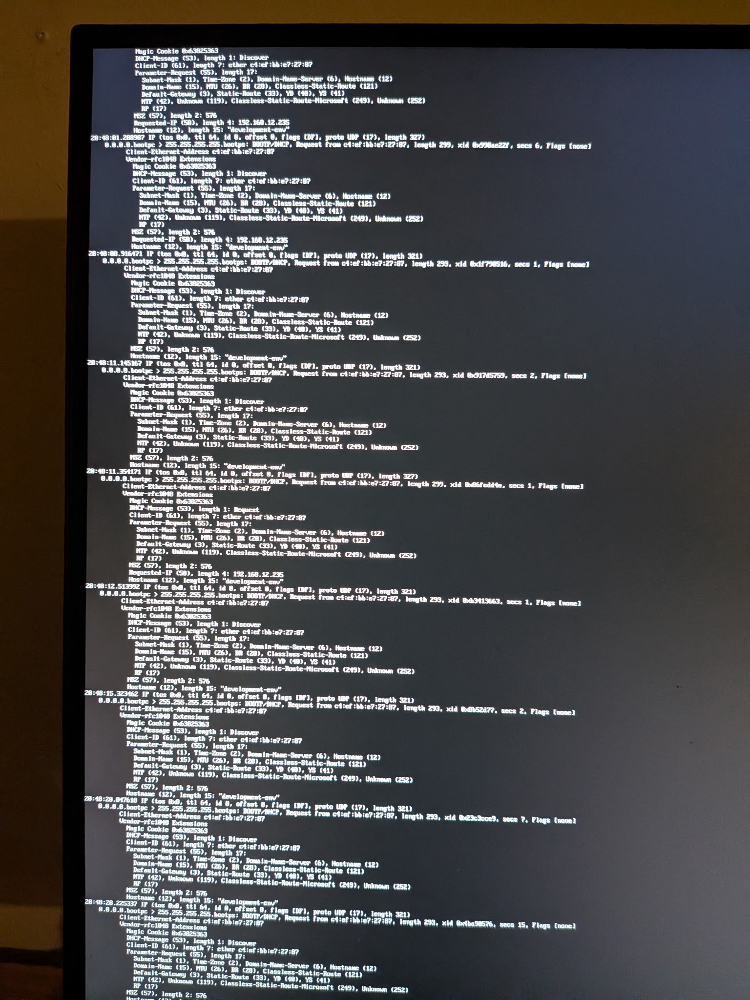

# Bare Metal Rocky Linux Edge Gateway

Building a Linux router from scratch forces you to understand exactly how packets traverse an operating system kernel. This project transforms a standard Rocky Linux 10 machine into an enterprise grade edge gateway. It leverages explicit kernel level configurations using iptables for NAT, dnsmasq for authoritative DHCP, and OpenSCAP for strict security auditing.

### The Architecture



The gateway utilizes a router on a stick topology. A single physical network interface connects to a Netgear GS305E managed switch, acting as an 802.1Q trunk port. This single cable simultaneously carries multiple isolated virtual networks.

VLAN 2 handles the upstream WAN connection to the ISP modem. VLAN 10 serves the standard local area network for workstations. VLAN 30 provides a strictly isolated network for bare metal Kubernetes nodes.

| Switch Port | Cable Destination | Mode | Membership | PVID |
| --- | --- | --- | --- | --- |
| 1 | ISP Modem | Access | VLAN 2 (U) | 2 |
| **2** | **Rocky Linux Mini PC** | **Trunk 802.1Q** | **VLAN 2 (T), VLAN 10 (T), VLAN 30 (T), VLAN 1 (U)** | **1** |
| 3 | Workstation | Access | VLAN 10 (U) | 10 |
| 4 | Workstation | Access | VLAN 10 (U) | 10 |
| 5 | k8s Node | Access | VLAN 30 (U) | 30 |
| 6 | k8s Node | Access | VLAN 30 (U) | 30 |

### DNS Caching (dnsmasq)

To reduce upstream latency and minimize WAN queries, the router serves as an authoritative DHCP and caching DNS server for all local VLANs using dnsmasq.

As shown in the capture below, the initial external query for a domain takes ~55ms to resolve against the public upstream. The subsequent query is intercepted by the router's local RAM cache and served in 0ms, effectively eliminating DNS resolution delay for all downstream clients.



### Security and CIS Compliance

A router sits at the edge of the network and requires aggressive hardening. This appliance is audited against the strict CIS Red Hat Enterprise Linux 10 Benchmark for Level 2 Servers.

During the initial deployment, the automated bash remediation pipeline successfully elevated the system security posture by resolving over 200 misconfigurations. The initial pre hardening score was 64 percent. After running the security baselines script, the final compliance score reached 96.5 percent.

### [Pre-Hardening Compliance (64.6%)](https://abdalrahmanbashir.github.io/rocky-linux-edge-router/reports/10.10.0.1_2026-11-03_21-10/pre-report.html)

### [Post-Hardening Compliance (96.5%)](https://abdalrahmanbashir.github.io/rocky-linux-edge-router/reports/10.10.0.1_2026-11-03_21-10/post-report.html)

### Engineering Challenges and Solutions

Moving from a theoretical network topology to a working production gateway revealed three hidden network layer traps.

**Trap 1: The Stale DHCP Lease**
As shown in the capture below, when testing the local network, an Ubuntu client refused to acquire an IP address. Running tcpdump revealed the client was sending DHCP Option 50, aggressively requesting its previous IP address from a completely different subnet. Because the requested IP was outside the router configuration, dnsmasq silently discarded the packets. To prevent stubborn clients from holding onto dead leases, I configured dnsmasq as the absolute network authority. Adding the dhcp authoritative flag forces the router to actively reject invalid IP requests, forcing the client to accept a valid IP.



**Trap 2: The Silent Host Firewall**
Rocky Linux ships with firewalld enabled by default. While excellent for standard server workloads, its aggressive ingress filtering treated the VLAN sub interfaces as untrusted zones. It silently dropped incoming UDP broadcast traffic for DHCP right at the kernel level. For a dedicated multi VLAN router, explicit iptables rules are much more predictable. I disabled firewalld entirely and installed iptables services to handle stateful packet forwarding and NAT translation.

**Trap 3: The Routing Metric Collision**
After securing a DHCP lease, local clients could ping the router but could not reach the outside internet. Outbound pings resulted in 100 percent packet loss. The routing table revealed a massive collision. NetworkManager had assigned an IP address to both the raw physical parent interface and the VLAN 2 WAN sub interface. Because the raw physical interface had a lower routing metric, the kernel grabbed outbound packets and sent them out the physical port untagged. This completely bypassed the VLAN 2 tag and the NAT translation rule. I solved this by locking down the physical interface as a dumb layer 2 carrier. I stripped it of all IP addresses, told NetworkManager to permanently ignore it, and forced the VLAN 2 default gateway to take absolute routing priority.

### Quick Start Deployment

**Prerequisites: SSH and Sudo Configuration**
Because the security script automates remote hardening over SSH, it assumes you have a dedicated administrative user (like `labadmin`) configured on the target machines. To prevent the script from hanging on password prompts during the OpenSCAP execution, this user needs SSH key-based authentication and passwordless `sudo` privileges.

If you have not set this up yet, run these commands on your target router:
```bash
useradd labadmin
usermod -aG wheel labadmin
echo "labadmin ALL=(ALL) NOPASSWD:ALL" > /etc/sudoers.d/labadmin
chmod 0440 /etc/sudoers.d/labadmin

```

**1. Deploy Routing Infrastructure**
Execute the main setup script to provision the VLANs, configure dnsmasq, and establish the iptables NAT forwarding rules.

```bash
chmod +x router-setup.sh
./router-setup.sh

```

**2. Execute Compliance Hardening**
Run the OpenSCAP pipeline against the provided inventory list to automatically apply the CIS Level 2 Server baseline.

```bash
chmod +x security-baselines.sh
./security-baselines.sh -f servers.txt -u labadmin

```
